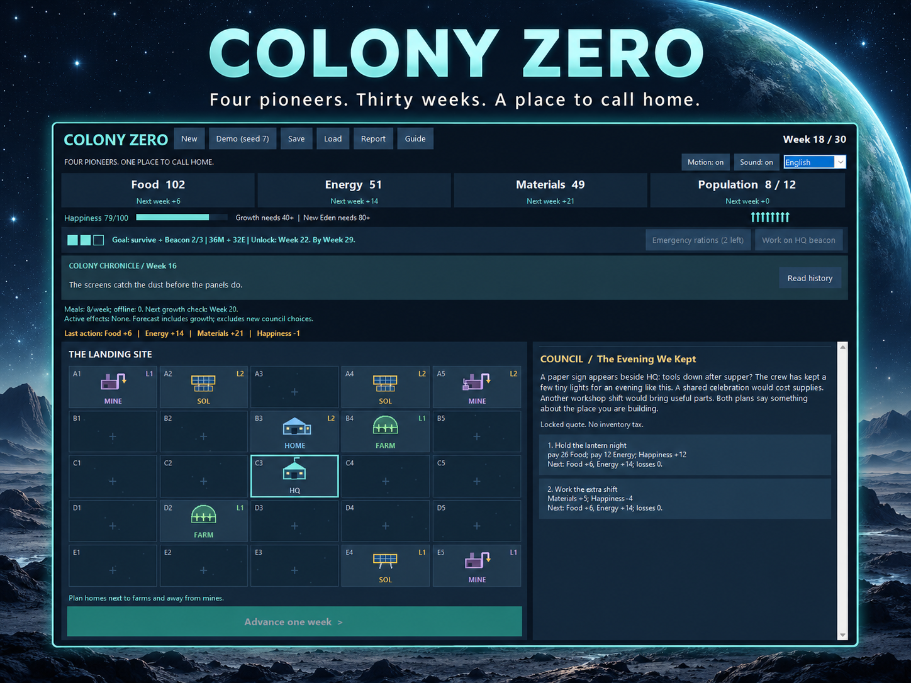
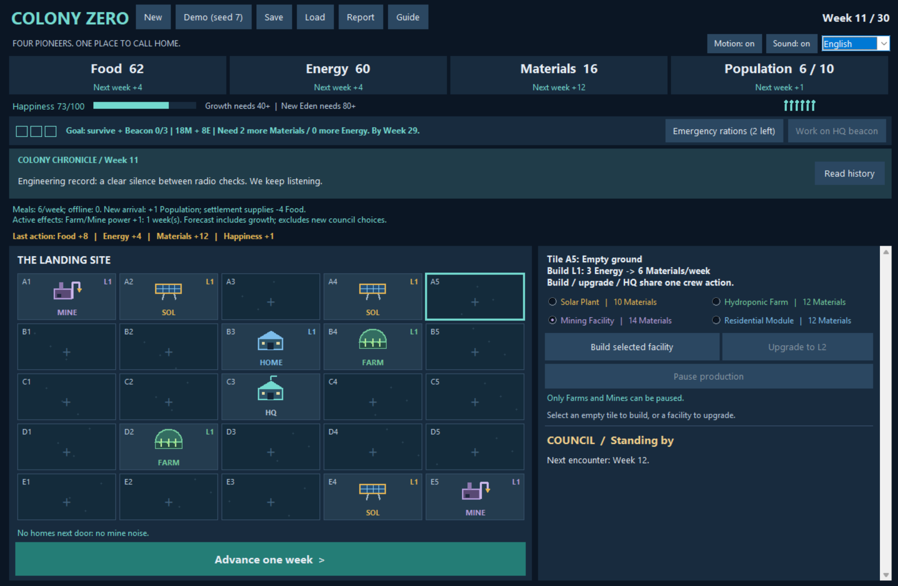

# Colony Zero

**Four pioneers. Thirty weeks. A place to call home.**


Colony Zero is a turn-based science-fiction colony game built with Python and Tkinter. Turn a small landing site into a settlement: place buildings, balance supplies, welcome newcomers and decide how to respond when things go wrong. Before the supply ship passes, your colony needs a working rescue beacon—and people still there to answer it.

**Current version: V3.3 — Make Room for Home**  
[简体中文说明](README_中文版.md)

## Gameplay

A colony in progress, with upgraded facilities and a choice between a shared celebration and another workshop shift.



## At a glance

- A 5×5 map with four building types and one upgrade level.
- Food, Energy, Materials and Population, alongside housing and Happiness.
- Twelve encounters with two choices each, from solar storms to a shared colony dinner.
- Production controls: pause a farm to save power, or keep it running to build food reserves.
- Next-week forecasts, colony chronicles and several ending ratings.
- JSON saves, live English/Chinese switching and optional sound effects.

## Getting started

You need **Python 3.10 or later with Tkinter** and a desktop display. The window is resizable, with a minimum content area of **980×680**. The game uses the Python standard library; there are no packages to install with `pip`.

Open a terminal in the folder containing `main.py` and run:

```bash
python main.py
```

On Windows, `py main.py` also works. On macOS or Linux, use `python3 main.py` if that is your Python command. In IDLE, open `main.py` and press **F5**.

To check that Tkinter is available:

```bash
python -m tkinter
```

Tkinter opens a separate desktop window. A browser terminal without a graphical display will need a local desktop Python installation to play.

## Your first colony

You begin with four pioneers, a central HQ, 20 Food, 12 Energy and 42 Materials. Your goal is to **survive 30 weeks and complete all three beacon stages before advancing into Week 30**.

1. Click an empty tile, choose a building and select **Build selected facility**.
2. Check the small forecast numbers beneath your supplies. They show the expected change at the next settlement.
3. Select **Advance one week** to produce resources, feed residents and move time forward.
4. When a council encounter appears, choose a response before continuing.
5. Prepare for the beacon stages as they unlock. Each stage uses the same weekly crew action as construction.

You have **one crew action per week**: build, upgrade or work on HQ. Establish food and power, develop a material supply, then expand as the colony can support it. The **Report** explains the full resource calculation; **Guide** keeps the rules close at hand.

## Buildings and supplies

Costs below are paid in Materials. Production and upkeep apply each week while a facility is running and powered.

| Building | Build cost | Level 1 | Upgrade cost | Level 2 |
|---|---:|---|---:|---|
| Solar Plant | 10 | Produces 7 Energy | 8 | Produces 12 Energy |
| Hydroponic Farm | 12 | Uses 3 Energy; produces 6 Food | 10 | Uses 4 Energy; produces 9 Food |
| Mining Facility | 14 | Uses 3 Energy; produces 6 Materials | 10 | Uses 4 Energy; produces 9 Materials |
| Residential Module | 12 | Adds 4 housing; uses 1 Energy | 8 | Adds 6 housing; uses 1 Energy |

Each resident needs **1 Food per week**. New residents can arrive every four weeks when housing, food, power and Happiness allow. Growth requires at least **40 Happiness**.

Placement matters. A powered farm beside a home produces **2 extra Food**. A home beside an unpaused mine loses **2 Happiness per week**, up to a colony-wide noise penalty of 4. These links use horizontal and vertical neighbours.

Power goes to homes, then farms, then mines. The map marks facilities that will lack power at the next settlement. Extra food can buy flexibility: select a farm or mine and use **Pause production** to stop its output and power use. Switching costs no crew action. A paused mine also stops contributing noise. Use **Resume production** when you want it back; temporary effects keep counting down while a facility is paused.

### Emergency rations

Twice per expedition, halve the next settlement's food demand, rounded up. Each order costs **8 Happiness** and pauses population growth for that settlement. Hover over the button for help; the first activation opens a preview before confirmation.

### The rescue beacon

| Stage | Unlocks after completed week | Materials | Energy |
|---|---:|---:|---:|
| 1 | 6 | 18 | 8 |
| 2 | 14 | 28 | 18 |
| 3 | 22 | 36 | 32 |

Each stage takes one crew action and adds 3 Happiness. Finish by **Week 29**. The objective strip shows your progress, next cost and missing supplies.

## Encounters, stories and endings

Twelve council encounters appear across the expedition. Choices can spend supplies, change the community or affect production for several weeks. Costs and consequences appear on the cards, with a next-settlement preview for available choices. Later costs scale with population and expedition phase.

The **Colony Chronicle** brings residents' reactions and milestones into the main view. **Read history** opens the retained stories and action log; the Report also recalls the colony's recorded milestones.

Losing every resident ends the expedition. Surviving without a completed beacon leaves a **Stranded Colony**. A rescued settlement receives an overall rating:

- **New Eden:** at least 13 residents, 80 Happiness and a score of 390.
- **Prosperous Colony:** at least 11 residents, 65 Happiness and a score of 300.
- **Struggling Outpost:** the colony survives and is rescued, with room to grow.

## Controls and settings

| Control | Action |
|---|---|
| Map click / arrow keys | Select a tile; click the map first for keyboard navigation |
| New / Demo (seed 7) | Start a shuffled expedition / a repeatable expedition |
| Save / Load | Save or restore a JSON game |
| Report / Guide | Read production details / gameplay rules |
| Read history | Open the colony's retained narrative and action history |
| Language | Switch between English and Simplified Chinese |
| Sound / Motion | Toggle short sound cues / reduce visual effects |

The game starts in English with sound off. Sound effects use Windows' built-in `winsound`; play remains silent on other platforms. Graphics are drawn with Tkinter Canvas, and the included WAV cues are generated tones.

Save files include your map, resources, production switches, event order and progress. Earlier saves keep their original campaign rules; choose **New** to start the current 30-week expedition with production controls.

## Try a saved scenario

Use **Load** to open a file from `examples/`.

| File | Try this |
|---|---|
| `power_management_before.json` | Select A1 and compare the forecast before pausing, after pausing and after resuming |
| `week05_ration_preview.json` | See how emergency rations affect a food shortage |
| `week14_arrival_choice.json` | Decide whether to welcome two surveyors |
| `week23_beacon_ready.json` | Complete the final beacon stage |
| `week29_before_arrival.json` | Advance into the final week and see a completed colony |

The 15 current scenarios sit directly in `examples/`. Earlier saves are grouped by game version for compatibility tests:

```text
examples/
├── *.json          # 15 current V3.3 scenarios
└── legacy/
    ├── V2.x/       # 8 saves shared by V2.0 and V2.1
    ├── V3.0/       # 10 saves
    └── V3.1/       # 12 saves
```

## Project structure and tests

| Files | Purpose |
|---|---|
| `main.py` | Start the application |
| `engine.py`, `events.py` | Game rules, production, forecasts and encounters |
| `gui.py`, `dialogs.py`, `localized_widgets.py` | Interface, readers and interactive controls |
| `visuals.py`, `soundfx.py` | Canvas graphics and optional audio |
| `i18n.py` | Interface translation |
| `narrative.py`, `polish.py`, `chronicle.py` | Stories, reactions and chronicle presentation |
| `persistence.py` | JSON saving, loading, validation and migration |
| `assets/`, `examples/`, `tests/` | Sound files, saved scenarios and automated tests |

The engine uses independent two-dimensional lists for tiles, levels and production switches. File I/O stores expeditions as JSON, and exception handling reports invalid actions or files while preserving the current colony.

Run the tests from the project folder:

```bash
python -m unittest discover -s tests -v
```

The suite has **202 tests** covering rules, previews, saves, compatibility and interface behaviour. GUI tests require a desktop display. V3.3 was tested on Windows with Python 3.12.14 and Tk 8.6.12.

## Release history

### V3.3 — Make Room for Home

- Enlarged the map and introduced a wider layout with compact-screen support and scrollable details.
- Brought the latest colony chronicle into the main view, with a dedicated history reader.
- Added persistent pause/resume controls for individual farms and mines.

### V3.2 — Know the Choice, Remember the Home

- Added ration previews, beacon reminders, game-styled readers and event-choice forecasts.
- Expanded stories and sound cues; refined three late encounters and colony ratings.

### V3.1 — A Place to Call Home

- Changed the campaign to 30 weeks and twelve encounters, including new weather and production pressures.
- Expanded colony stories, building artwork, animations and resource feedback; introduced optional sound.

### V3.0 — Thirty Days to Send a Signal

- Extended the campaign to 30 days, added two encounters, the rescue beacon and emergency rations, and rebalanced the longer expedition.

### V2.1 — Live Bilingual UI

- Added live English/Simplified Chinese switching throughout the game.

### V2.0 — Placement and Consequences

- Added placement bonuses, mine noise, housing upkeep, timed effects and shared settlement forecasts.

### V1.5 — Buildings and Community

- Added Level 2 upgrades, Happiness, vector icons, keyboard selection and resource-change feedback.

### V1.0 — First Landing

- Introduced the 15-day colony with four building types, six encounters, survival, scoring and JSON saves.

## AI assistance

OpenAI Codex was used throughout development for Python implementation, tests, game text, documentation, and the code-generated visual and audio assets. Requirements and revisions were guided by the project brief and iterative gameplay feedback.
